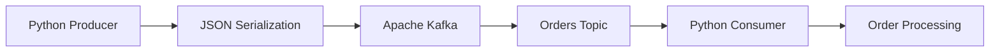

# ⚡ Kafka Order Processing System

A Python-based, event-driven order processing system built using **Apache Kafka**. This project demonstrates asynchronous communication between producers and consumers using Kafka's distributed messaging architecture.

The system publishes order events to a Kafka topic, where consumers independently subscribe to and process incoming messages.

## 🚀 Project Overview

This project demonstrates how Apache Kafka can be used to build asynchronous, loosely coupled backend systems.

Instead of directly communicating with another service, the producer publishes an order event to Kafka. The consumer subscribes to the `orders` topic and processes the event independently.

### Key Features

- **Event-Driven Architecture:** Asynchronous communication using Apache Kafka.
- **Kafka Producer:** Publishes order data as JSON messages.
- **Kafka Consumer:** Subscribes to Kafka topics and processes incoming orders.
- **Docker Integration:** Runs Kafka using Docker Compose.
- **JSON Serialization:** Converts Python objects into JSON messages.
- **Python Integration:** Uses the `kafka-python` library.

## 🏗️ System Architecture



### How It Works

1. The producer creates an order containing customer, product, amount, and status information.
2. The order is serialized into JSON.
3. The producer publishes the message to the Kafka `orders` topic.
4. Kafka stores the message in the topic.
5. The consumer subscribes to the topic.
6. The consumer receives and deserializes the message.
7. Order information is displayed in the terminal.

## 🛠️ Technology Stack

| Technology | Purpose |
|---|---|
| Python | Application development |
| Apache Kafka 4.1.1 | Distributed event streaming |
| kafka-python | Python Kafka integration |
| Docker | Kafka containerization |
| Docker Compose | Infrastructure management |
| JSON | Message serialization |

## 📂 Project Structure

```text
kafka-order-system/
│
├── producer.py          # Publishes order events
├── consumer.py          # Consumes order events
├── docker-compose.yml   # Kafka infrastructure
├── requirements.txt     # Python dependencies
└── README.md            # Project documentation
```

## ⚙️ Installation & Setup

### Prerequisites

Make sure you have installed:

- Python 3.10+
- Docker Desktop
- Docker Compose
- Git

### 1. Clone the Repository

```bash
git clone https://github.com/ChinmayBhattt/kafka-order-system.git

cd kafka-order-system
```

### 2. Create a Virtual Environment

```bash
python3 -m venv venv
```

Activate the environment:

**macOS / Linux**

```bash
source venv/bin/activate
```

**Windows**

```bash
venv\Scripts\activate
```

### 3. Install Dependencies

```bash
pip install -r requirements.txt
```

### 4. Start Apache Kafka

Make sure Docker Desktop is running.

Start Kafka using Docker Compose:

```bash
docker compose up -d
```

Check whether the Kafka container is running:

```bash
docker ps
```

Kafka is configured to listen on:

```text
localhost:9092
```

## ▶️ Running the Application

You need two terminal windows.

### Terminal 1: Start the Consumer

```bash
source venv/bin/activate
python consumer.py
```

Expected output:

```text
Waiting for orders...
```

The consumer will wait for incoming messages on the `orders` topic.

### Terminal 2: Run the Producer

```bash
source venv/bin/activate
python producer.py
```

Expected output:

```text
Order successfully sent to Kafka!
```

### Consumer Output

After receiving the order event, the consumer displays:

```text
New Order Received!

Order ID: 101
Customer: Chinmay
Product: Laptop
Amount: 50000
Status: ORDER_PLACED
```

## 📦 Sample Order Event

The producer sends the following JSON message:

```json
{
  "order_id": 101,
  "customer": "Chinmay",
  "product": "Laptop",
  "amount": 50000,
  "status": "ORDER_PLACED"
}
```

## 🔧 Kafka Configuration

The application uses the following Kafka configuration:

| Configuration | Value |
|---|---|
| Bootstrap Server | localhost:9092 |
| Topic | orders |
| Message Format | JSON |
| Consumer Offset | earliest |
| Auto Commit | Enabled |
| Kafka Version | 4.1.1 |
| Deployment | Docker Compose |
| Kafka Mode | KRaft |

## 🐛 Troubleshooting

### 1. Kafka Connection Refused

**Error:**

```text
NoBrokersAvailable
```

**Solution:**

Ensure Docker is running and Kafka has started successfully.

```bash
docker compose up -d
docker ps
```

### 2. Kafka Container Not Running

Check container status:

```bash
docker compose ps
```

Check Kafka logs:

```bash
docker compose logs -f kafka
```

### 3. Python Module Not Found

**Error:**

```text
ModuleNotFoundError: No module named 'kafka'
```

**Solution:**

```bash
source venv/bin/activate
pip install -r requirements.txt
```

### 4. Stop Kafka

```bash
docker compose down
```

## 🎯 Learning Objectives

Through this project, I explored:

- Apache Kafka fundamentals.
- Event-driven system architecture.
- Producer and consumer implementation.
- Asynchronous message communication.
- Kafka topics and message consumption.
- JSON serialization and deserialization.
- Docker-based infrastructure setup.
- Python integration with distributed messaging systems.

## 👨‍💻 Author

**Chinmay Bhatt**

AI & Data Science | Backend Development | Distributed Systems | Agentic AI

- GitHub: [@ChinmayBhattt](https://github.com/ChinmayBhattt)
- Project Repository: [Kafka Order System](https://github.com/ChinmayBhattt/kafka-order-system)

---

⭐ If you find this project useful, consider giving it a star!
